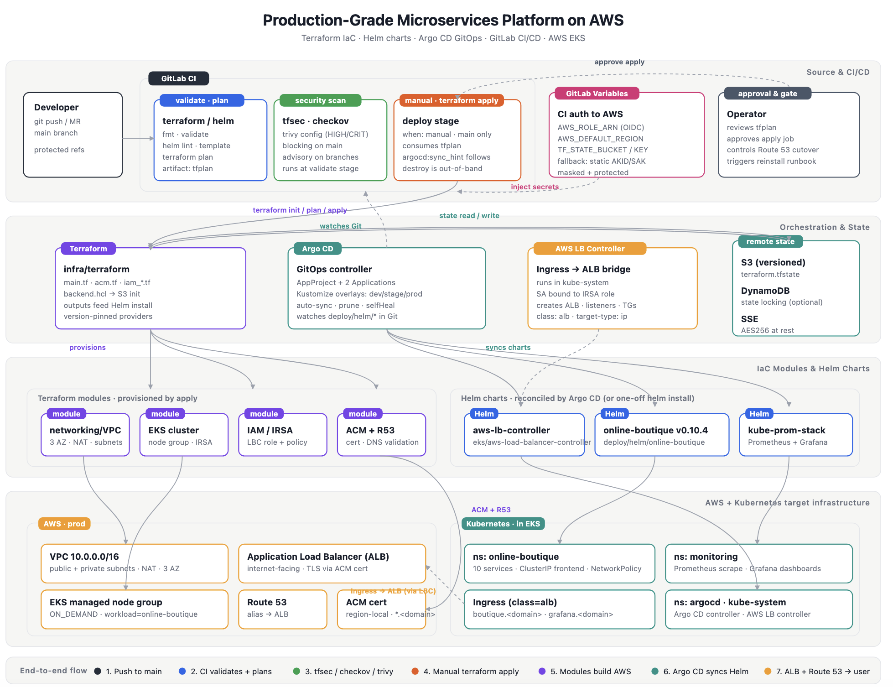

# Production-Grade Microservices Platform on AWS

Deploy and operate [Google Online Boutique](https://github.com/GoogleCloudPlatform/microservices-demo) (**v0.10.4**) on **AWS EKS** with **Terraform**, **GitLab CI**, **Argo CD** GitOps, **ALB + ACM** ingress, and **kube-prometheus-stack** observability.



---

## Documentation

| Document | Description |
|----------|-------------|
| [docs/README.md](docs/README.md) | Documentation index |
| [docs/architecture/](docs/architecture/) | Overview, design, roadmap, project plan |
| [docs/onboarding/](docs/onboarding/) | Deploy guide and full runbook |
| [docs/runbooks/](docs/runbooks/) | Troubleshooting and operations |
| [docs/diagrams/](docs/diagrams/) | Screenshots and architecture PNGs |
| [docs/incident-response/](docs/incident-response/) | Severity, escalation, rollback |
| [SECURITY.md](SECURITY.md) | Security model and controls |
| [CHANGELOG.md](CHANGELOG.md) | Repository change history |

**Azure sibling:** [micser-apps-Azure-Terraform-Helm-GitOps-monitoring](https://github.com/btilki/micser-apps-Azure-Terraform-Helm-GitOps-monitoring) · **GCP sibling:** [micser-apps-GCP-Terraform-Helm-GitOps-monitoring](https://github.com/btilki/micser-apps-GCP-Terraform-Helm-GitOps-monitoring)

---

## Quick start

```bash
# Prerequisites: terraform, aws, kubectl, helm — see docs/onboarding/README.md
cp infra/terraform/terraform.tfvars.example infra/terraform/terraform.tfvars
cp infra/terraform/backend.hcl.example infra/terraform/backend.hcl
# Edit tfvars, backend.hcl, GitLab CI variables, Argo overlays — see docs/onboarding/deployment.md

make tf-init tf-plan    # then tf-apply when ready
make kubeconfig
# Bootstrap LBC + Argo CD + secrets — docs/onboarding/runbook.md
make argo-apply ARGO_OVERLAY=prod
```

**Full runbook:** [docs/onboarding/runbook.md](docs/onboarding/runbook.md)

---

## Platform capabilities

- **IaC:** VPC, EKS, IRSA for AWS Load Balancer Controller, optional ACM (`infra/terraform/`)
- **CI:** GitLab validate, IaC scans, plan, manual apply (OIDC to AWS)
- **GitOps:** Argo CD + Helm (`deploy/argocd/`, `deploy/helm/online-boutique/`)
- **Security:** Digest-pinned images, NetworkPolicy egress baseline
- **Observability:** Prometheus / Grafana via Argo CD

---

## Repository layout

```text
├── README.md, LICENSE, Makefile, SECURITY.md, CODEOWNERS, CHANGELOG.md
├── .gitlab-ci.yml, .pre-commit-config.yaml, .editorconfig
├── infra/terraform/          # AWS foundation
├── deploy/
│   ├── helm/online-boutique/ # Application chart
│   └── argocd/               # GitOps manifests + overlays
└── docs/
    ├── architecture/
    ├── onboarding/
    ├── runbooks/
    ├── diagrams/
    └── incident-response/
```

---

## Scope

- One EKS cluster; environments via Argo overlays (`dev` / `stage` / `prod`)
- Fixed app release **v0.10.4** (upstream Google images)
- External traffic: **Ingress (ALB)** only — no storefront `LoadBalancer` Service

---

## Local development

```bash
make help          # all targets
make validate      # terraform validate
make helm-lint     # helm lint + template
pre-commit install # optional — see .pre-commit-config.yaml
```

---

## License

See [LICENSE](LICENSE). Online Boutique application is upstream open source (Google); see [NOTICE](NOTICE).
