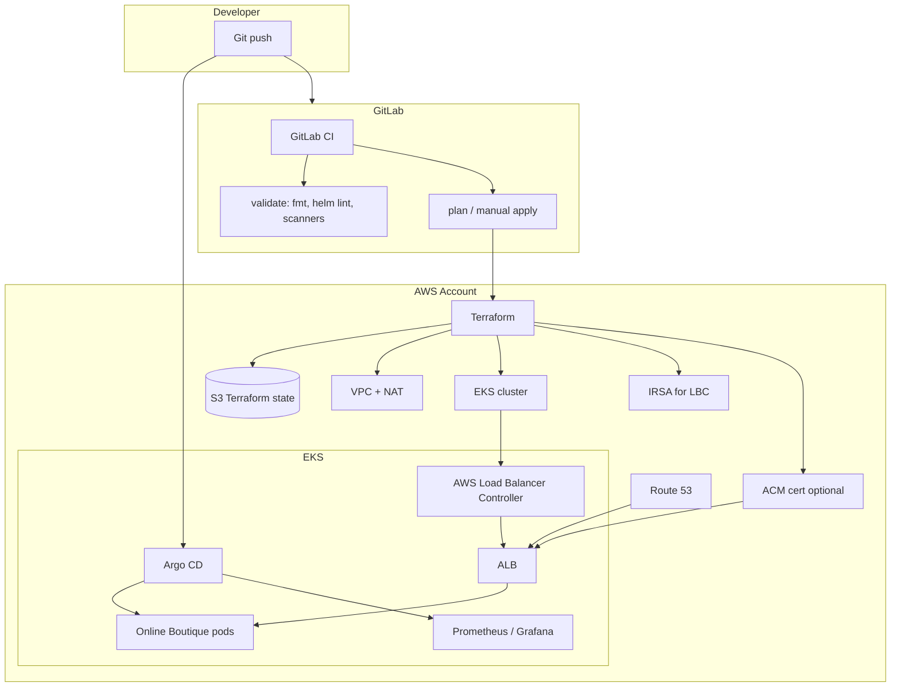
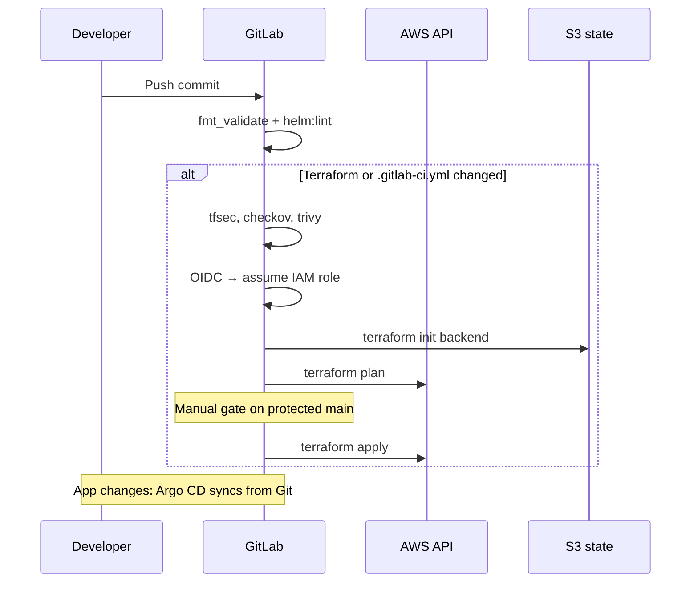
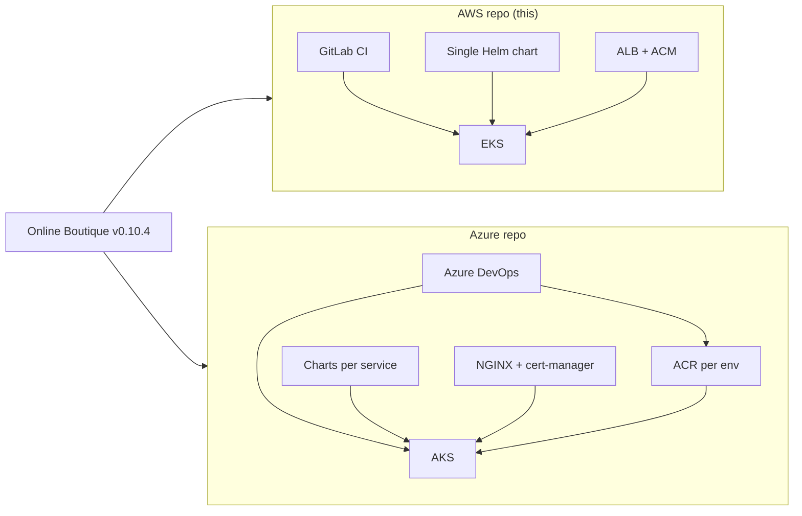

# Architecture & design — Online Boutique on AWS

**Status:** As-built (matches repository layout)  
**Application release:** microservices-demo **v0.10.4**  
**Companion:** [project-plan.md](./project-plan.md) · [overview.md](./overview.md) · [README.md](../../README.md)  
**Azure counterpart:** [micser-apps-Azure-Terraform-Helm-GitOps-monitoring](https://github.com/btilki/micser-apps-Azure-Terraform-Helm-GitOps-monitoring)

---

## 1. Executive summary

This document describes the **as-built architecture** for running Google’s Online Boutique on **Amazon EKS**. A single Terraform stack provisions networking and the cluster. **GitLab CI** validates and optionally applies infrastructure changes. **Argo CD** deploys application and monitoring Helm releases from Git. North–south traffic enters through an **AWS Application Load Balancer (ALB)** created by the **AWS Load Balancer Controller**; TLS uses **ACM** certificates. Workloads use **digest-pinned** images from Google’s upstream registry (plus digest-pinned Redis and Busybox). A baseline **NetworkPolicy** pack restricts pod egress while allowing in-namespace traffic, DNS, and optional HTTPS/HTTP to the internet for external APIs required by the application (e.g. currency data).

---

## 2. Goals and non-goals

### 2.1 Goals

- **Infrastructure as code** for VPC, EKS, IAM (IRSA for LBC), optional ACM.
- **Separation of concerns:** CI owns Terraform; GitOps owns Kubernetes workloads.
- **Production-shaped edge:** Ingress (not `LoadBalancer` Service for the storefront).
- **Observable platform:** Prometheus, Grafana, Alertmanager via kube-prometheus-stack.
- **Verifiable security posture:** IaC scans in CI, immutable images, network egress policies.

### 2.2 Non-goals

- Rewriting Online Boutique application code.
- Multi-region or multi-cluster active-active.
- Per-environment AWS accounts or ECR promotion pipelines (see Azure sibling for that pattern).
- Service mesh, WAF, or full zero-trust micro-segmentation.

---

## 3. Application overview

Online Boutique is an e-commerce **polyglot microservices** application. Services communicate via **gRPC** except the **frontend** (HTTP on port 8080).

### 3.1 Services in this Helm chart

All of the following are defined in `deploy/helm/online-boutique/templates/workloads.yaml` (upstream-equivalent layout, no `frontend-external` LoadBalancer Service):

| Service | Role |
|---------|------|
| `frontend` | HTTP UI — only service exposed via Ingress |
| `cartservice` | Cart API (uses Redis) |
| `productcatalogservice` | Product catalog |
| `currencyservice` | Currency conversion (may call external HTTP APIs) |
| `checkoutservice` | Checkout orchestration |
| `paymentservice` | Mock payments |
| `shippingservice` | Shipping quotes |
| `emailservice` | Mock email |
| `recommendationservice` | Recommendations |
| `adservice` | Ads |
| `loadgenerator` | Synthetic traffic (optional via `loadgenerator.enabled`) |
| `redis-cart` | Redis for cart state |

### 3.2 Image supply chain

| Image set | Source | Pinning |
|-----------|--------|---------|
| Microservices | `us-central1-docker.pkg.dev/google-samples/microservices-demo/<service>` | `values.yaml` → `image.digests.<service>` rendered by `templates/_helpers.tpl` as `@sha256:…` |
| Redis | `docker.io/library/redis@sha256:…` | Full reference in `values.yaml` |
| Busybox (init) | `docker.io/library/busybox@sha256:…` | Load generator init container |

Tag fallback: if a digest key is omitted, Helm renders `registry/service:tag` (`tag` defaults to `v0.10.4`).

---

## 4. Environment model

### 4.1 Logical environments

| Environment | Mechanism | Cluster |
|-------------|-----------|---------|
| `dev` | `deploy/argocd/overlays/dev/` | **Same** EKS cluster |
| `stage` | `deploy/argocd/overlays/stage/` | **Same** EKS cluster |
| `prod` | `deploy/argocd/overlays/prod/` | **Same** EKS cluster |

**Important:** Overlays change Argo CD `Application` parameters (repo URL, hostname, ACM ARN). They do **not** provision separate EKS clusters or AWS accounts in the current Terraform root module.

### 4.2 Namespace layout (typical bootstrap)

| Namespace | Contents |
|-----------|----------|
| `online-boutique` | Boutique Helm release |
| `monitoring` | kube-prometheus-stack (Grafana, Prometheus, …) |
| `argocd` | Argo CD control plane |
| `kube-system` | AWS Load Balancer Controller, core addons |

### 4.3 Isolation mechanisms (current vs stronger future)

| Mechanism | Current repo | Stronger variant (Azure sibling inspiration) |
|-----------|--------------|-----------------------------------------------|
| Namespace | Per app stack | Per env (`dev`/`stage`/`prod` namespaces) |
| NetworkPolicy | Helm chart — default-deny egress + allows | Per-env deny/allow tiers in GitOps |
| Image registry | Shared Google registry + digests | Per-env ECR + promotion |
| ResourceQuota | Not in chart | `gitops/platform/` style quotas |
| Pod Security | Container `securityContext` in workloads | Namespace PSS labels |

---

## 5. High-level platform architecture

### 5.1 Platform overview



### 5.2 Request path (storefront)

```text
Internet
  → Route 53 (A/AAAA alias)
  → ALB (HTTPS, ACM certificate)
  → Ingress (class: alb, target-type: ip)
  → Service frontend:80
  → Pod frontend:8080
  → gRPC to internal ClusterIP services
```

Frontend sets `ENV_PLATFORM=aws` in the Deployment (Helm template).

---

## 6. AWS infrastructure design

### 6.1 Terraform module topology

```text
infra/terraform/
├── main.tf          # module.vpc, module.eks
├── locals.tf        # cluster_name slug, tags
├── variables.tf     # region, node sizing, ACM inputs, API endpoint CIDRs
├── outputs.tf       # kubectl hint, subnet IDs, IRSA ARN, ACM ARN
├── providers.tf     # AWS provider only (no k8s provider at apply time)
├── versions.tf      # required Terraform / provider versions
├── acm.tf           # optional ACM + Route 53 validation records
└── iam_aws_load_balancer_controller.tf
```

### 6.2 Network (VPC)

| Design choice | Setting | Rationale |
|---------------|---------|-----------|
| AZ count | Up to 3 AZs from available zones | EKS requires ≥ 2; 3 for modest HA |
| Subnets | Private (workers) + public (ALB) | Standard EKS pattern |
| NAT | `single_nat_gateway = true` | Cost control for non-HA staging; trade HA for NAT |
| Subnet tags | `kubernetes.io/role/elb` / `internal-elb` | Required for LBC subnet discovery |

**CIDR:** Default `vpc_cidr` from `variables.tf` (see `terraform.tfvars.example`).

### 6.3 EKS cluster

| Attribute | Design |
|-----------|--------|
| Node group | Single managed group `main`, ON_DEMAND |
| IRSA | Enabled (`enable_irsa = true`) |
| Control plane logs | api, audit, authenticator, controllerManager, scheduler → CloudWatch |
| Secrets encryption | KMS key; `cluster_encryption_config` for Kubernetes secrets |
| API endpoint | Public and/or private per variables; **restrict public CIDRs** for real production |
| Admin | `enable_cluster_creator_admin_permissions = true` — convenient for bootstrap; tighten for enterprise |

### 6.4 IAM — AWS Load Balancer Controller (IRSA)

Terraform creates an IAM role trusted by the `aws-load-balancer-controller` service account. After apply:

1. Install controller Helm chart in `kube-system`.
2. Annotate ServiceAccount: `eks.amazonaws.com/role-arn=<output aws_load_balancer_controller_irsa_role_arn>`.

Policy document: `infra/terraform/policies/aws-load-balancer-controller-iam-policy.json`.

### 6.5 TLS and DNS

| Component | Responsibility |
|-----------|----------------|
| ACM | Issue cert for `app_certificate_domain_name` when domain + `route53_hosted_zone_id` set |
| Route 53 | DNS validation records; operator creates **alias** records to ALB for app/Grafana/Argo hostnames |
| Ingress | `alb.ingress.kubernetes.io/certificate-arn` annotation on Ingress resources |

---

## 7. Kubernetes application design

### 7.1 Helm chart structure

| Path | Role |
|------|------|
| `Chart.yaml` | Chart metadata (`version` 0.2.0, `appVersion` 0.10.4) |
| `values.yaml` | Images, ingress, networkPolicy, loadgenerator flag |
| `templates/workloads.yaml` | Deployments, Services, ServiceAccounts |
| `templates/ingress.yaml` | ALB Ingress for frontend |
| `templates/networkpolicies.yaml` | Conditional NetworkPolicy resources |
| `templates/_helpers.tpl` | Image string helper |
| `files/upstream-kubernetes-manifests.yaml` | Reference only — not packaged |

### 7.2 Ingress (ALB)

Key values under `ingress` and `ingress.alb`:

- `className: alb`
- `scheme: internet-facing`, `targetType: ip`
- Listeners HTTP→HTTPS redirect, health check `/_healthz`
- `certificateArn` must match region and hostname coverage

### 7.3 NetworkPolicy design

When `networkPolicy.enabled: true` (default in `values.yaml`):

| Policy | Effect |
|--------|--------|
| `default-deny-egress` | Deny all egress (if `defaultDenyEgress`) |
| `allow-same-namespace-egress` | Pods may talk to other pods in namespace |
| `allow-dns-egress` | UDP/TCP 53 to `kube-system` |
| `allow-internet-https-http-egress` | TCP 80/443 to `0.0.0.0/0` when `allowInternetEgress` |

**Tradeoff:** Internet egress supports application behavior (e.g. currency APIs). For stricter posture, set `allowInternetEgress: false` and add `ipBlock` rules for known endpoints.

**Prerequisite:** Cluster must use a **CNI that enforces NetworkPolicy** (Amazon VPC CNI supports it).

---

## 8. GitOps design (Argo CD)

### 8.1 Resources

| Resource | File | Purpose |
|----------|------|---------|
| AppProject | `deploy/argocd/project.yaml` (+ `base/project.yaml`) | RBAC scope for applications |
| Application `online-boutique` | `base/online-boutique-application.yaml` + overlay patches | Helm path `deploy/helm/online-boutique` |
| Application `monitoring` | `base/monitoring-application.yaml` + overlay patches | Upstream `kube-prometheus-stack` chart |

### 8.2 Sync policy (boutique app)

From base Application:

- Automated sync with **prune** and **selfHeal**
- `CreateNamespace=true`

### 8.3 Overlay patches

Each overlay Kustomization patches:

- `repoURL`, `targetRevision`
- Helm parameters: `ingress.host`, `ingress.alb.certificateArn`
- Monitoring: Grafana ingress host, ALB certificate annotation

Committed prod overlay uses **placeholders** (`your-group/your-repo`, `example.com`, `123456789012`) for safe forking — replace before real deployment.

### 8.4 Bootstrap sequence (not in Git)

Argo CD itself is installed from upstream stable manifest (runbook). Only **Applications** are repo-managed after bootstrap.

---

## 9. CI/CD architecture (GitLab)

### 9.1 Flow



### 9.2 Authentication

**Preferred:** GitLab OIDC token → `AWS_ROLE_ARN` (web identity).  
**Fallback:** `AWS_ACCESS_KEY_ID` / `AWS_SECRET_ACCESS_KEY` in CI variables.

Trust policy templates: `infra/terraform/policies/gitlab-oidc-trust-policy*.example.json`.

### 9.3 State

- Remote backend: S3 (`TF_STATE_BUCKET`, `TF_STATE_KEY`, optional DynamoDB lock).
- Local `backend.hcl` must match CI variables (README).

---

## 10. Observability architecture

| Component | Deployment |
|-----------|------------|
| Prometheus | kube-prometheus-stack |
| Grafana | Ingress on ALB (patch per overlay) |
| Alertmanager | Included in stack (rules configurable upstream) |
| App metrics | ServiceMonitor patterns from chart defaults |

**Secret:** `grafana-admin-credentials` in namespace `monitoring` — created manually before sync (not in Git).

**Validation:** `kubectl get pods -n monitoring`; HTTPS to Grafana hostname (README).

---

## 11. Security architecture summary

| Layer | Control |
|-------|---------|
| Source | No secrets in Git; `.gitignore` for tfvars/backend |
| CI | Scanners on IaC changes; manual apply |
| AWS IAM | OIDC for CI; IRSA for LBC |
| K8s RBAC | EKS access via aws-auth / access entries (bootstrap user) |
| Workload | non-root, dropped capabilities, read-only root FS where set |
| Network | NetworkPolicy egress baseline |
| Images | Digest pinning |

**Gaps to mention honestly:** Grafana secret bootstrap; optional wide internet egress; single cluster multi-overlay env model.

---

## 12. Operational flows

### 12.1 Steady-state change

| Change type | Path |
|-------------|------|
| Terraform | MR → GitLab plan → manual apply |
| Helm values / Argo manifests | MR → merge → Argo sync |
| Emergency | Avoid `kubectl edit` in prod path; prefer Git revert |

### 12.2 Teardown order

1. Delete Argo apps / overlays  
2. Helm uninstall (best effort)  
3. Delete namespaces  
4. `terraform destroy` with same backend  

See [README — Teardown](../README.md#teardown-uninstall-helm-workloads-before-infrastructure-destroy).

---

## 13. Architecture decision records (summary)

| ID | Decision | Rationale | Tradeoff |
|----|----------|-----------|----------|
| ADR-001 | Single EKS cluster | Cost and operational simplicity for v1 | Weaker blast radius than account-per-env |
| ADR-002 | Argo CD for apps, CI for Terraform | Clear separation; GitOps audit trail | Two systems to learn |
| ADR-003 | ALB Ingress + ACM vs in-cluster cert-manager | Native AWS TLS integration | AWS-specific coupling |
| ADR-004 | One Helm chart for all boutique services | Fast parity with upstream manifest | Less granular release than per-service charts |
| ADR-005 | Upstream Google images + digests | No app CI in this repo | No `build once promote` story on AWS (Azure has ACR import) |
| ADR-006 | Path-gated Terraform jobs in CI | Save runner time and AWS API calls | Helm-only changes skip IaC scans (still get helm:lint) |
| ADR-007 | NetworkPolicy with optional internet egress | Application works out of the box | Not least-privilege egress |

---

## 14. Comparison diagram (AWS vs Azure sibling)



---

## 15. Repository map (design view)

| Path | Architectural role |
|------|---------------------|
| `infra/terraform/` | Foundation layer |
| `.gitlab-ci.yml` | Infrastructure pipeline |
| `deploy/helm/online-boutique/` | Application packaging |
| `deploy/argocd/` | Continuous delivery desired state |
| `docs/diagrams/` | Verification artifacts |
| `docs/architecture/` | Overview, design, plan, roadmap |
| `docs/onboarding/` | Deployment guide and runbook |
| `docs/runbooks/` | Troubleshooting |
| `README.md` | Repository entry hub |

---

## 16. References

- [README.md](../../README.md) — Repository entry hub  
- [../onboarding/runbook.md](../onboarding/runbook.md) — Install runbook, CI variables, outputs  
- [project-plan.md](./project-plan.md) — Phases, CI matrix, success criteria  
- [Google microservices-demo](https://github.com/GoogleCloudPlatform/microservices-demo)  
- [EKS best practices](https://aws.github.io/aws-eks-best-practices/)  
- [Azure project ARCHITECTURE.md](https://github.com/btilki/micser-apps-Azure-Terraform-Helm-GitOps-monitoring/blob/main/ARCHITECTURE.md)
