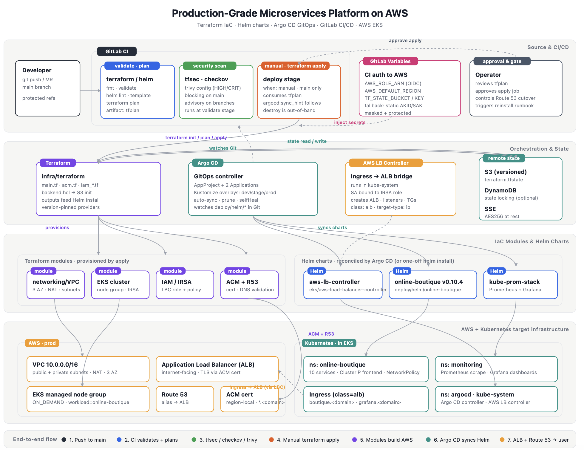
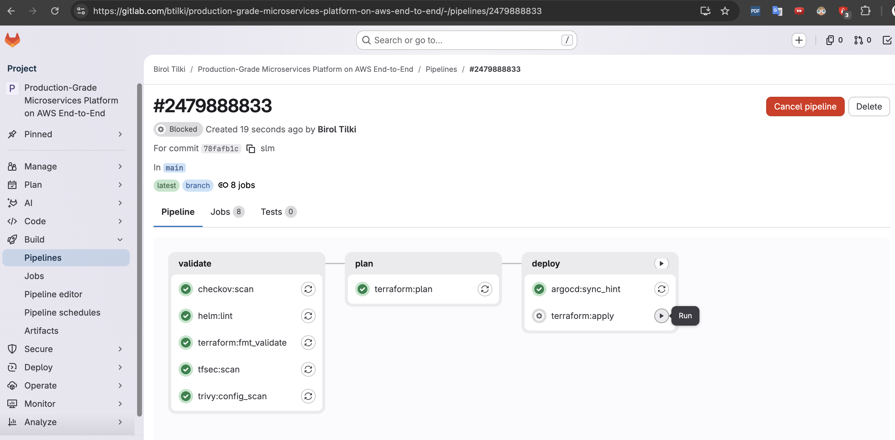
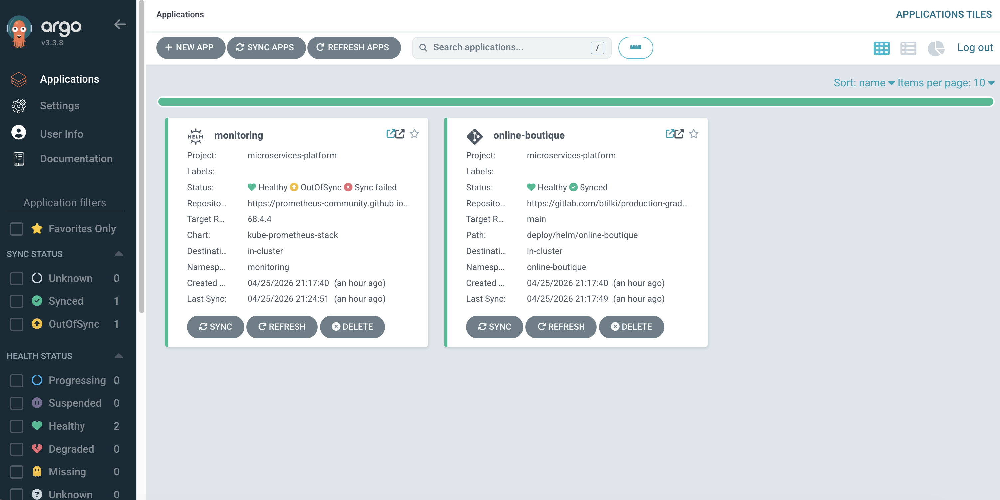
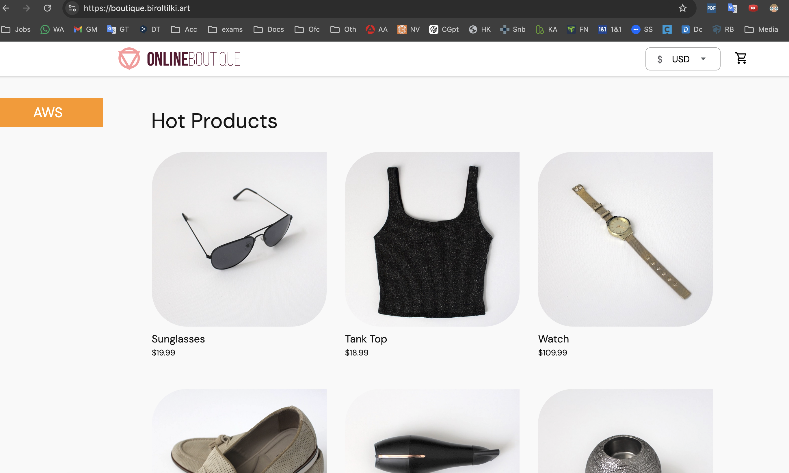
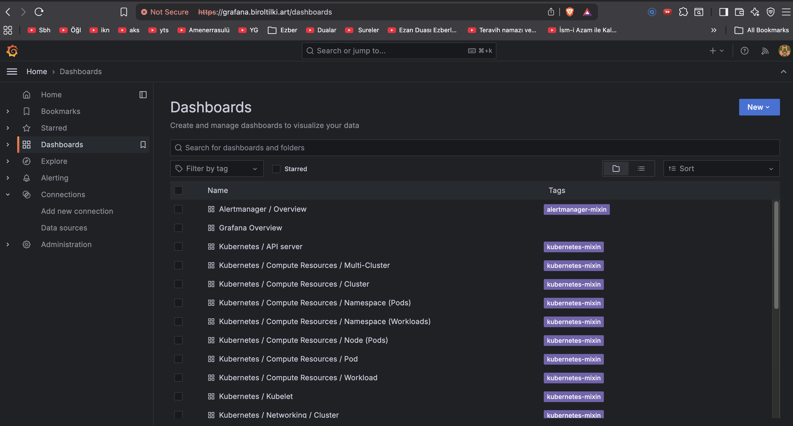
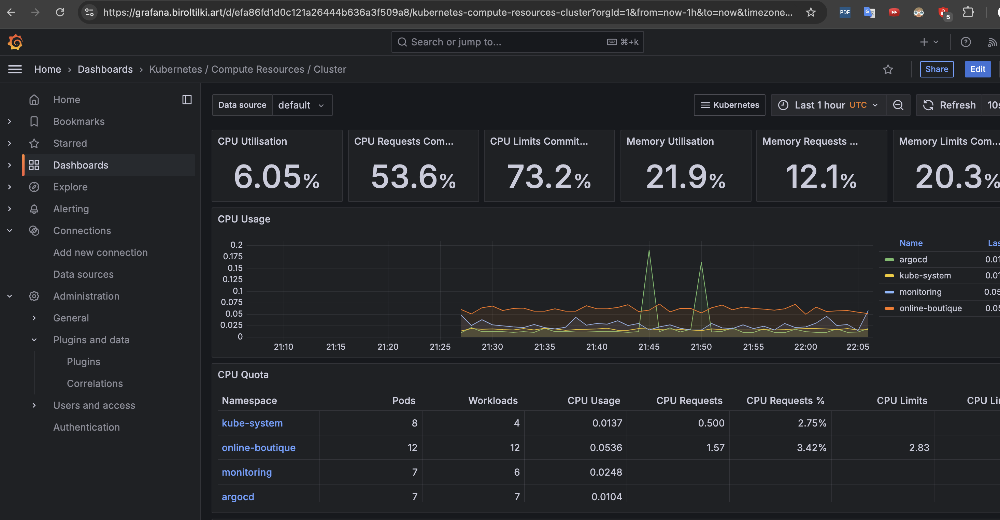

# Running Google’s Online Boutique on AWS EKS with Terraform, GitLab CI, and Argo CD

*A practical platform engineering guide to IaC, GitOps, ALB + ACM TLS, and kube-prometheus-stack observability.*

---

## Introduction

Most teams do not struggle with writing a `Deployment` YAML file. They struggle with operating the full **production** stack: networking, a Kubernetes control plane, identity, TLS at the edge, and observability.

[Google's Online Boutique](https://github.com/GoogleCloudPlatform/microservices-demo) (microservices-demo **v0.10.4**) is a useful workload for that story. It is a real polyglot system - Go, C#, Node.js, and more - that exercises load balancing, service discovery, configuration, and logging without being too complex for a single engineer deployment.

This article walks through the AWS platform: what it does, how the pieces connect, which trade-offs I accepted, and how it compares to a parallel deployment on **Azure Kubernetes Service (AKS)** in a sibling repository.

---

## Platform architecture

Start with the two delivery paths.

At the highest level, two paths change the system:

1. **Infrastructure** — merge requests → GitLab CI → Terraform → VPC, EKS, IAM, optional ACM.
2. **Workloads** — merge requests → Git → Argo CD → Helm → Online Boutique + monitoring stack.

Users reach the shop over **Route 53** → **ALB (TLS)** → **Ingress** → `frontend` Service → gRPC to internal microservices.



*Figure 1 — Platform overview (VPC, EKS, ALB, CI, GitOps).*

The detailed design, ADR summary, and CI job matrix live in the repository under `docs/architecture/design.md` and `docs/architecture/project-plan.md`.

---

## Infrastructure layer: Terraform on AWS

The infrastructure is managed as one Terraform root module.

Everything under `infra/terraform/` is a single root module that provisions:

| Component | Role |
|-----------|------|
| **VPC** | Public subnets (ALB), private subnets (EKS nodes), NAT for egress |
| **EKS** | Managed node group, control plane logging, KMS encryption for Kubernetes secrets |
| **IRSA** | IAM role for the **AWS Load Balancer Controller** so Ingress objects create ALBs |
| **ACM** (optional) | TLS certificate when you provide a domain and Route 53 hosted zone |

State lives in **S3** (with optional DynamoDB locking). Use the same backend configuration locally and in CI so state never diverges between your laptop and GitLab.

**Design choices worth naming:**

- **Single NAT gateway** — lower cost for non-production scale; you trade some AZ resilience on egress.
- **One EKS cluster** — `dev`, `stage`, and `prod` are **Argo CD overlays**, not three clusters. That keeps operations simple; blast radius is larger than account-per-environment models.
- **OIDC from GitLab to AWS** — CI assumes an IAM role via web identity instead of long-lived access keys in variables.

After `terraform apply`, you install the Load Balancer Controller with the IRSA annotation from Terraform outputs, then bootstrap Argo CD once. Steady-state infrastructure changes go through GitLab without manual intervention.

---

## Delivery: GitLab CI

CI is split into fast feedback and controlled change execution.

The pipeline in `.gitlab-ci.yml` separates **fast feedback** from **expensive or risky** jobs.

**Every push:**

- `terraform fmt` + `validate` (no AWS credentials required)
- `helm lint` + `helm template` smoke test for the Online Boutique chart

**Only when `infra/terraform/**` or `.gitlab-ci.yml` changes:**

- **tfsec**, **Checkov**, **Trivy** on Terraform
- `terraform plan` (artifact saved)
- Manual `terraform apply` on protected `main`

This path gating saves runner time and avoids unnecessary AWS API calls when changes are limited to documentation or Helm templates.



*Figure 2 — GitLab CI validate and plan stages.*

Preferred authentication is **GitLab OIDC → `AWS_ROLE_ARN`**. Trust policy examples ship in `infra/terraform/policies/`. If plan fails with "no credentials," that is almost always a missing OIDC setup.

---

## GitOps: Argo CD and Helm

CI does not apply Kubernetes manifests directly.

Instead, **Argo CD** watches Git and syncs:

- **Online Boutique** — one Helm chart at `deploy/helm/online-boutique/` (full v0.10.4 workload)
- **Monitoring** — `kube-prometheus-stack` (Prometheus, Grafana, Alertmanager)

Base Applications live under `deploy/argocd/base/`; environment-specific hostnames and ACM certificate ARNs are patched in `deploy/argocd/overlays/{dev,stage,prod}/`.



*Figure 3 — Argo CD Applications for the boutique and monitoring stack.*

Sync policy uses automated prune and self-heal for non-production overlays. For a stricter production posture, you would disable auto-sync on production Applications and require an operator to click **Sync** after review.

### One chart, digest-pinned images

All microservice images come from Google's sample registry at release **v0.10.4**, rendered as `registry/service@sha256:…` via Helm helpers. Redis and Busybox init images are digest-pinned in `values.yaml`.

This gives you **immutable deployments** without building images in this repository. The trade-off: there is no ECR-per-environment promotion pipeline here (the Azure repo implements that with `az acr import`).

### Ingress and TLS

External traffic uses **Ingress** with `ingressClassName: alb` — not a `LoadBalancer` Service on the frontend. TLS terminates on the ALB using an **ACM certificate ARN** on the Ingress annotation. The ACM ARN is templated per overlay by Kustomize.

On Azure, the sibling project uses **NGINX Ingress**, **cert-manager**, and DNS-01 challenges — same responsibility, different components.

---

## Security baseline

The current baseline is practical and review-friendly.

The platform includes several controls you can point to in a design review:

1. **No secrets in Git** — `terraform.tfvars`, `backend.hcl`, and Grafana credentials stay out of version control.
2. **IaC scanning** — tfsec, Checkov, Trivy on Terraform changes (gated by path).
3. **NetworkPolicies** — default-deny egress, allow same-namespace traffic, DNS to `kube-system`, optional HTTPS/HTTP to the internet for external APIs required by the workload (e.g., currency data).
4. **Pod hardening** — non-root, dropped capabilities, read-only root filesystem where the upstream chart allows.
5. **Explicit edge** — only the frontend is exposed via Ingress.

**Known gaps (documented honestly):**

- Grafana admin credentials are still created with `kubectl` at bootstrap; **External Secrets Operator + AWS Secrets Manager** is the natural upgrade.
- Broad internet egress can be tightened per workload once you map which pods need outbound HTTP.
- Logical environments on one cluster should eventually use **separate namespaces** and stronger Argo **AppProjects** if you keep the single-cluster model.

See `SECURITY.md` in the repository for the full model.

---

## The running application

After bootstrap, the storefront path is straightforward.

Once Argo CD syncs and DNS is in place, the storefront is available over HTTPS. The Helm chart deploys the full microservices graph: cart, checkout, payment, email, recommendations, ads, and load generator.



*Figure 4 — Online Boutique UI served through ALB + ACM.*

Internal services stay **ClusterIP**; only the frontend Ingress is public. That matches how you would shape a real system: one controlled entrypoint, many internal gRPC hops.

---

## Observability

Observability follows the same GitOps pattern.

A second Argo CD Application installs **kube-prometheus-stack**. Grafana is exposed with its own ALB Ingress (hostname and certificate patched per overlay like the shop).



*Figure 5 — Grafana after deployment.*



*Figure 6 — Workload health visible in Grafana.*

Bootstrap still requires a Kubernetes Secret for Grafana admin credentials before the monitoring app syncs — plan for External Secrets in a hardened fork.

---

## How CI and GitOps divide responsibility

This split is the core operating model.

| Layer | Changed by | Tooling |
|-------|------------|---------|
| VPC, EKS, IAM, ACM | Platform team via MR | GitLab CI + Terraform |
| Helm chart, Argo manifests | Platform / app config via MR | Argo CD |
| LBC, Argo CD install | One-time bootstrap | Runbook (`docs/onboarding/runbook.md`) |

**Rule:** CI touches **AWS APIs**; Argo CD reconciles **Kubernetes**. Mixing them (e.g., CI running `kubectl apply` for apps on every merge) works for small teams but scales poorly; GitOps gives you auditability and rollback.

---

## AWS vs Azure: same workload, two clouds

The workload is the same. The cloud primitives differ.

I maintain a parallel repository for **AKS** with **Azure DevOps**, **per-environment ACRs**, digest promotion, and **NGINX + cert-manager** ingress. The application is the same; the platform primitives differ.

| Topic | AWS (this repo) | Azure (sibling) |
|--------|-----------------|-----------------|
| CI | GitLab CI | Azure DevOps |
| Ingress / TLS | ALB + ACM | NGINX + cert-manager |
| Images | Upstream digests in Helm | Per-env ACR + `acr import` promotion |
| Charts | Single Online Boutique chart | Chart per owned service |
| Docs layout | `docs/architecture`, `onboarding`, `runbooks` | ARCHITECTURE, DEPLOYMENT, SECURITY, phased guides |

Both implementations target the same platform engineering outcomes: **IaC, automated validation, GitOps, observability, and security baselines** — implemented with each cloud's native ingress and authentication.

---

## Repository layout (for operators)

If you are new to the repo, follow this order.

If you clone the project today, start here:

1. [README.md](../../README.md) — entry hub and `Makefile` targets  
2. [docs/architecture/overview.md](./overview.md) — short architecture  
3. [docs/onboarding/deployment.md](../onboarding/deployment.md) — phased deploy  
4. [docs/onboarding/runbook.md](../onboarding/runbook.md) — full commands  
5. [docs/runbooks/troubleshooting.md](../runbooks/troubleshooting.md) — when something fails  

Local checks before a merge request:

```bash
make validate
make helm-lint
pre-commit run --all-files   # optional
```

---

## What comes next

The roadmap keeps the platform direction clear.

The [roadmap](./roadmap.md) tracks follow-on work without changing the upstream application:

- **External Secrets Operator** for Grafana (and future API keys)  
- **Namespace-per-environment** on the same cluster with quotas and tighter NetworkPolicies  
- **Narrow egress** — replace wide `0.0.0.0/0` allows with workload-specific rules  
- Optional **ECR per environment** and promotion pipelines (AWS analogue of Azure ACR import)  

---

## Closing

Platform engineering is the work of making change **safe, observable, and repeatable**. Online Boutique is the actor; the play is Terraform foundations, protected CI, GitOps delivery, TLS at the load balancer, and dashboards that show when it works.

If you are building a similar system, fork the repository, replace placeholders in prod Argo overlays (repo URL, domain, ACM ARN), run the onboarding steps once, and keep your own screenshots in the repository.

Repository: [btilki/micser-apps-AWS-Terraform-Helm-GitOps-monitoring](https://github.com/btilki/micser-apps-AWS-Terraform-Helm-GitOps-monitoring)

The application remains upstream open source from Google; this repository documents **how to run it on AWS**. See `NOTICE` and `LICENSE` for attribution.

---

*All diagrams in this article are from `docs/diagrams/` in the repository.*
