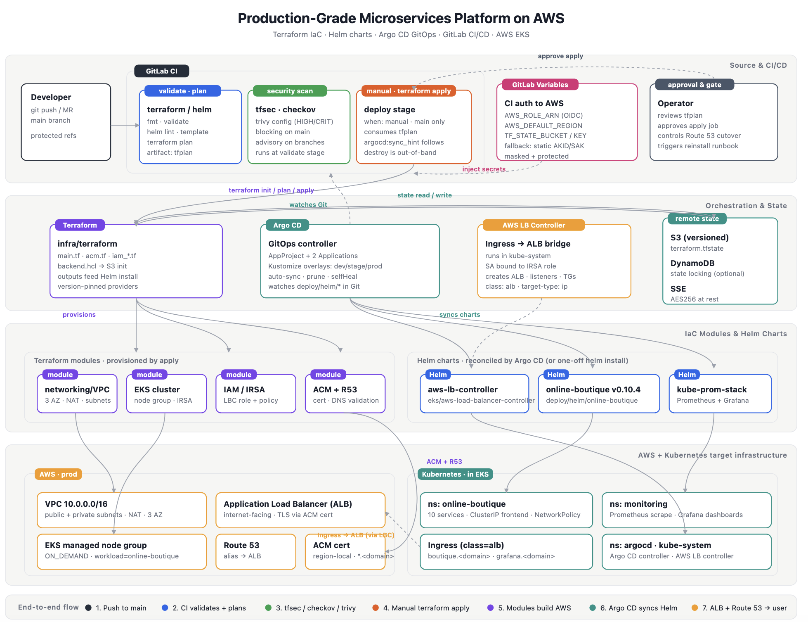

# Architecture overview

Online Boutique on **AWS EKS**: Terraform foundation, **GitLab CI**, **Argo CD** GitOps, **ALB + ACM** ingress, **kube-prometheus-stack**.

**Full design:** [design.md](design.md) · **Plan:** [project-plan.md](project-plan.md)



---

## Goals

- Infrastructure as code (Terraform) with S3 remote state
- Digest-pinned Helm deployment (microservices-demo **v0.10.4**)
- GitOps (Argo CD) with `dev` / `stage` / `prod` overlays on **one** EKS cluster
- HTTPS via ALB Ingress + ACM
- Baseline NetworkPolicy egress controls
- Observability via kube-prometheus-stack

---

## AWS topology

| Layer | Resources |
|-------|-----------|
| State | S3 (+ optional DynamoDB lock) |
| Network | VPC, public/private subnets, NAT |
| Compute | EKS managed node group |
| IAM | IRSA for AWS Load Balancer Controller |
| TLS | ACM + Route 53 (optional, via Terraform variables) |
| Edge | ALB via Load Balancer Controller |

Terraform: `infra/terraform/`

---

## CI/CD

| Concern | Owner |
|---------|--------|
| VPC, EKS, IAM, ACM | GitLab CI → Terraform (manual apply on protected `main`) |
| Workloads | Argo CD → Helm from Git |

Path-gated jobs: plan, apply, tfsec, Checkov, Trivy run only when `infra/terraform/**` or `.gitlab-ci.yml` changes.  
`terraform:fmt_validate` and `helm:lint` run every pipeline.

---

## Application

Single Helm chart: `deploy/helm/online-boutique/`.  
Only **frontend** exposed via Ingress; all other services are ClusterIP.

GitOps: `deploy/argocd/` (base + overlays).

---

## Repository layout (platform)

```text
├── README.md, LICENSE, Makefile, SECURITY.md, CODEOWNERS, CHANGELOG.md
├── .gitlab-ci.yml
├── infra/terraform/
├── deploy/helm/online-boutique/
├── deploy/argocd/
└── docs/
    ├── architecture/
    ├── onboarding/
    ├── runbooks/
    ├── diagrams/
    └── incident-response/
```
