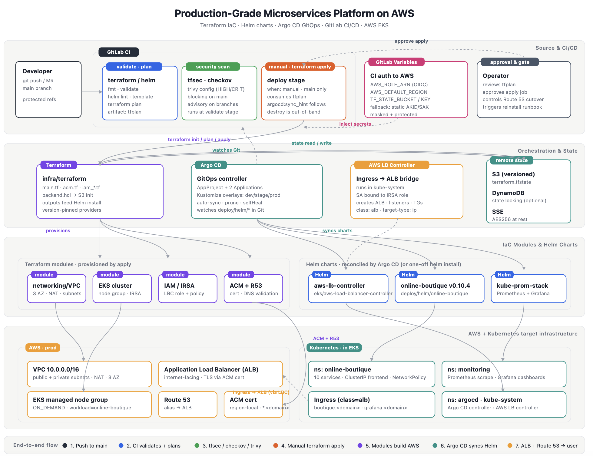
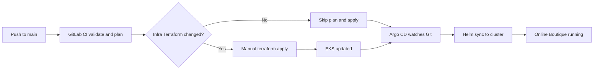
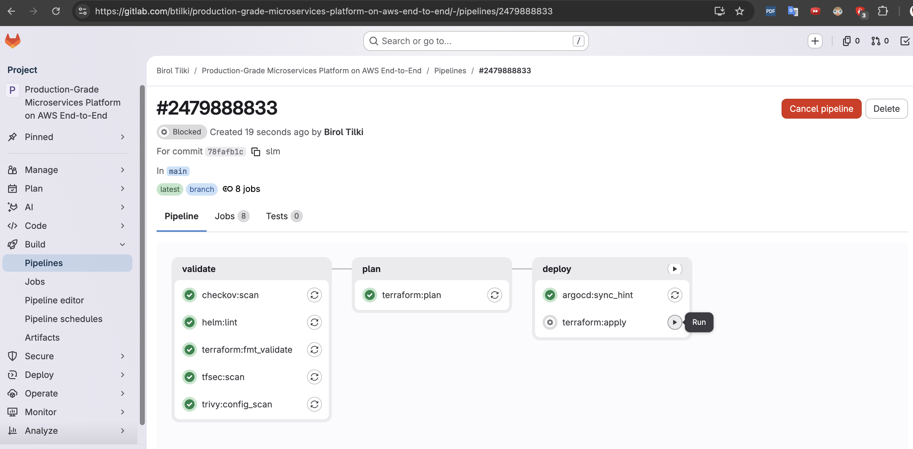
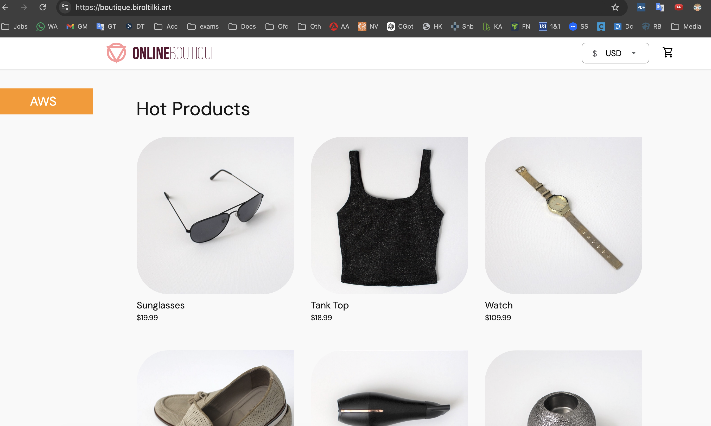
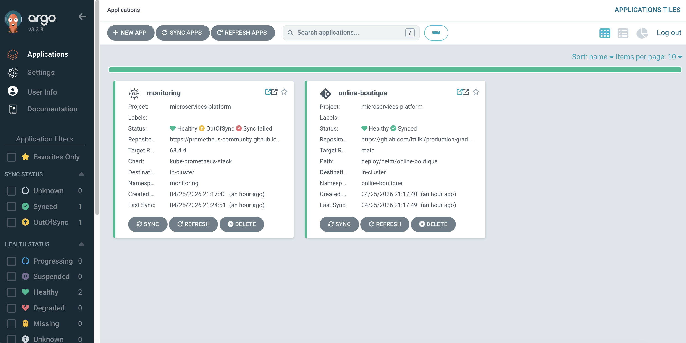
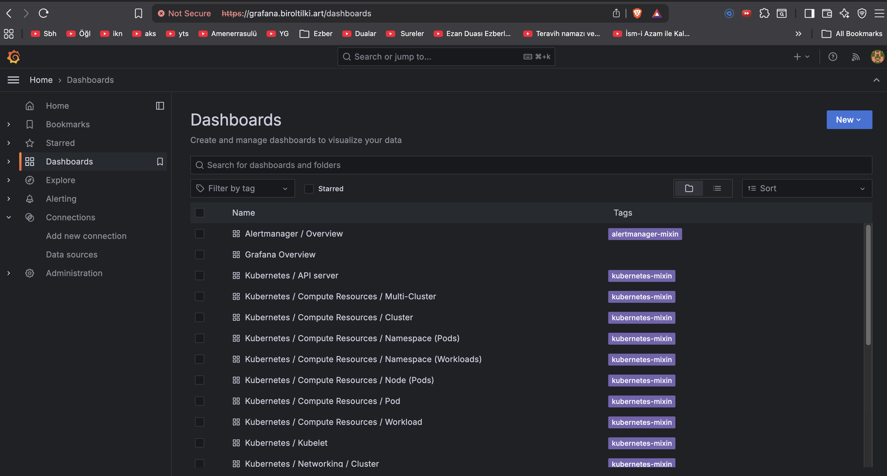
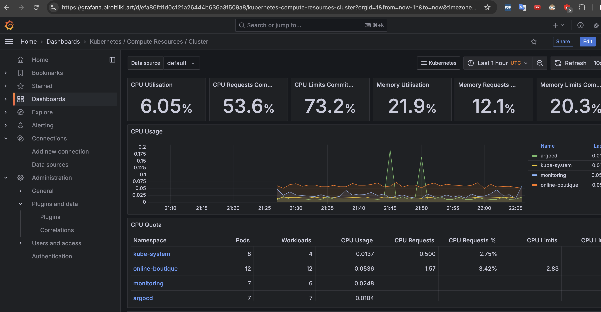

# Production-Grade Microservices Platform on AWS (End-to-End)

This repository deploys and operates
[Online Boutique](https://github.com/GoogleCloudPlatform/microservices-demo)
(**v0.10.4**) on AWS EKS as a production-shaped platform: Terraform foundation,
GitLab CI, Argo CD GitOps, ALB ingress with ACM TLS, and kube-prometheus-stack
observability.

### Production-Grade Microservices Platform on AWS Infrastructure Diagram


## Documentation

| Document | Description |
|----------|-------------|
| [docs/architecture/design.md](../architecture/design.md) | System design: AWS/EKS topology, CI/CD, GitOps, security, ADRs, Azure comparison |
| [docs/architecture/project-plan.md](../architecture/project-plan.md) | Scope, phases, CI/GitOps plan, roadmap, go-live checklist |
| [docs/architecture/medium-article-revised.md](../architecture/medium-article-revised.md) | Publishable article (copy to Medium); platform comparison vs [Azure sibling](https://github.com/btilki/micser-apps-Azure-Terraform-Helm-GitOps-monitoring) |

> **Note:** The canonical entry hub is [README.md](../../README.md). This file is the **detailed operator runbook** (install, CI variables, teardown, diagrams).

## Start here (suggested reading order)

Use this order for the fastest understanding and execution:

1. [docs/architecture/design.md](../architecture/design.md) -> [docs/architecture/project-plan.md](../architecture/project-plan.md) (design and plan)
2. `Scope` -> `Platform capabilities` -> `Architecture (target)` -> `Repository structure`
3. `Local prerequisites` -> `Install Runbook`
4. `GitLab CI — AWS credentials for Terraform` -> `Terraform state backend standardization` -> `Operational flow`
5. `Monitoring phase` -> `Argo CD overlay edit checklist` -> `Monitoring validation`
6. `Teardown: Uninstall Helm workloads (before infrastructure destroy)`
7. `Production readiness evidence` (screenshots under Install Runbook) -> `Terraform variables` -> `Terraform outputs` -> `Reference: Notes`

## Scope

- Single AWS account and single EKS cluster with environment-specific GitOps overlays (`dev`, `stage`, `prod`).
- Environments are logical overlays in GitOps manifests, not separate EKS clusters.
- Online Boutique fixed release: **`v0.10.4`**.
- AWS EKS deployment using **Terraform**.
- Production-shaped entrypoint: **Ingress (ALB)** + **Route 53** + **TLS (ACM)**.
- **GitOps** with **Argo CD** (implemented).
- **CI** with **GitLab CI** (implemented).

## Platform capabilities

- Infrastructure as Code with Terraform (VPC, EKS, IAM, optional ACM).
- Kubernetes operations on EKS.
- Ingress-oriented design with TLS termination on ALB.
- GitOps with Argo CD and CI patterns in GitLab.
- Helm chart supply-chain controls: **digest-pinned** container images and **NetworkPolicy** egress baselines (enabled by default; tune `networkPolicy.*` in `deploy/helm/online-boutique/values.yaml`).
- GitLab CI: Terraform **fmt/validate**, **Helm lint**, and IaC scanners (**tfsec**, **Checkov**, **Trivy**) with path-based gating for plan/apply and scanner jobs (see GitLab CI section).

## Architecture (target)

- **Compute:** AWS EKS (managed node group).
- **Network:** VPC with public and private subnets and NAT.
- **Ingress:** AWS Load Balancer Controller (ALB Ingress class).
- **DNS:** Route 53 record for the application hostname.
- **TLS:** ACM certificate referenced by the Ingress.
- **Application:** Online Boutique from  
  `us-central1-docker.pkg.dev/google-samples/microservices-demo/<service>` at release **`v0.10.4`**, deployed via Helm using **immutable digests** in `values.yaml` (helper in `templates/_helpers.tpl`; omitting a digest key falls back to `:<tag>` for that component). Redis and Busybox sidecar images are digest-pinned in the same values file.

## Repository structure

```text
infra/terraform/
  main.tf              # VPC module, EKS module
  locals.tf            # cluster slug, tags, ACM flag, kubectl hint
  variables.tf
  outputs.tf
  providers.tf         # AWS only (avoids chicken-and-egg with empty cluster)
  versions.tf
  acm.tf               # Optional ACM + Route 53 validation
  iam_aws_load_balancer_controller.tf
  policies/
    aws-load-balancer-controller-iam-policy.json
  terraform.tfvars.example
  .terraform.lock.hcl  # commit this for reproducible provider versions
deploy/helm/online-boutique/
  Chart.yaml           # chart version; appVersion matches boutique release
  values.yaml          # ingress host/cert, image digests, networkPolicy.*, redis/busybox
  templates/
    _helpers.tpl        # Helm helper: registry/service@digest (or :tag fallback)
    workloads.yaml      # upstream-equivalent workloads (no frontend-external)
    ingress.yaml        # ALB Ingress → Service/frontend:80
    networkpolicies.yaml  # egress policy pack (default on via values.networkPolicy)
    NOTES.txt
  files/
    upstream-kubernetes-manifests.yaml  # reference copy of upstream v0.10.4 (not packaged)
README.md
```

Added scaffolding:

- `deploy/argocd` — Argo CD `AppProject` + `Application` manifests and usage notes.
- `.gitlab-ci.yml` — Validate: Terraform fmt/validate, Helm lint/template, tfsec, Checkov, Trivy; plan and manual apply on Terraform or CI changes (details in GitLab CI section).

## Operational flow



## Recommended implementation and maintenance flow

- Use a hybrid model:
  - manual for first-time bootstrap operations,
  - GitLab CI for Terraform validate/plan/apply,
  - Argo CD for integrating Kubernetes applications and monitoring systems.
- Bootstrap once manually (Terraform apply, Argo CD install/apply, DNS/ACM, required secrets), then move to CI + GitOps for steady-state.
- Keep Terraform changes controlled through merge requests and protected `main` approvals; use shared remote state (`TF_STATE_BUCKET`) to avoid drift.
- Keep Kubernetes workload changes in Git only and let Argo CD sync; avoid ad-hoc manual `kubectl`/`helm` changes in production paths.
- For teardown, remove Helm-managed workloads first when needed, then run `terraform destroy` from the same state context.

## GitLab CI — AWS credentials for Terraform

GitLab runners are not EC2 instances with an instance profile, so **`terraform plan` / `apply` need AWS credentials**.

Preferred setup: **GitLab OIDC + IAM role assumption**.

In your GitLab project: **Settings → CI/CD → Variables**, add:

| Variable | Notes |
|----------|--------|
| `AWS_ROLE_ARN` | IAM role trusted by GitLab OIDC (recommended for production) |
| `AWS_DEFAULT_REGION` | Optional; pipeline defaults to `eu-central-1` (must match `infra/terraform` region) |
| `TF_STATE_BUCKET` | **Required**. S3 bucket used by CI backend `terraform init` |
| `TF_STATE_KEY` | Recommended to set explicitly. If omitted, CI defaults to `$CI_PROJECT_PATH_SLUG/terraform.tfstate` |
| `TF_STATE_LOCK_TABLE` | Optional DynamoDB lock table name (legacy-style locking) |

Fallback (legacy) static credentials:

| Variable | Notes |
|----------|--------|
| `AWS_ACCESS_KEY_ID` | IAM access key; **Masked** + **Protected** recommended |
| `AWS_SECRET_ACCESS_KEY` | IAM secret key; **Masked** + **Protected** recommended |

If neither OIDC nor static credentials are provided, CI fails with an authentication error.
If both are present, current pipeline prefers OIDC (`AWS_ROLE_ARN`) first.

**Path-based job rules:** `terraform:plan`, `terraform:apply`, and the IaC security jobs (`tfsec`, `checkov`, `trivy`) run only when something under `infra/terraform/` or `.gitlab-ci.yml` changes. That avoids AWS API calls and heavy scanner images on documentation-only or Helm-only commits.

**Jobs that still run on every pipeline:** `terraform:fmt_validate` (fmt + validate, no AWS backend) and `helm:lint` (lint + `helm template` smoke render with dummy ingress values).

OIDC trust policy template:

- `infra/terraform/policies/gitlab-oidc-trust-policy.example.json`
- Replace `<AWS_ACCOUNT_ID>`, `<GROUP>`, and `<PROJECT>` before attaching to the IAM role used by `AWS_ROLE_ARN`.
- For stricter access (protected refs only), use:
  - `infra/terraform/policies/gitlab-oidc-trust-policy.protected.example.json`

## Terraform state backend standardization

To avoid duplicate-resource errors between local and CI applies, use one canonical backend location everywhere.

Canonical values for this project:

- `TF_STATE_BUCKET`: `use-unique-bucket-name`
- `TF_STATE_KEY`: `use-unique-key`
- `AWS_DEFAULT_REGION`: `your-region-name`

Set the same values in both places:

1. GitLab CI/CD Variables (`TF_STATE_BUCKET`, `TF_STATE_KEY`, `AWS_DEFAULT_REGION`)
2. `infra/terraform/backend.hcl`

Example `backend.hcl`:

```hcl
bucket  = "microservices-tfstate-123456789012-eu-central-1"
key     = "your-gitlab-project-path-slug/terraform.tfstate"
region  = "eu-central-1"
encrypt = true
```

Operational notes:

- Always run `terraform destroy` **before** deleting state objects or the state bucket.
- Deleting the S3 state bucket first causes state loss; remaining AWS resources must then be imported or cleaned manually.
- Keep local and CI backend values identical to prevent duplicate `AlreadyExists` errors.

## Monitoring phase

Monitoring is deployed as a second Argo CD application from the selected overlay:

- `deploy/argocd/base/monitoring-application.yaml` (shared defaults)
- `deploy/argocd/overlays/<env>/monitoring-patch.yaml` (env-specific host and certificate)
- Helm chart source: `prometheus-community/kube-prometheus-stack`

Before apply, set Grafana host and ACM certificate ARN in your environment overlay, and create the Kubernetes Secret `grafana-admin-credentials` in namespace `monitoring` in Install Runbook section.

## Argo CD overlay edit checklist

Before `kubectl apply -k deploy/argocd/overlays/<env>`, confirm:

- `deploy/argocd/overlays/<env>/online-boutique-patch.yaml`
  - `spec.source.repoURL`
  - `spec.source.targetRevision`
  - `ingress.host`
  - `ingress.alb.certificateArn`
- `deploy/argocd/overlays/<env>/monitoring-patch.yaml`
  - `grafana.ingress.hosts[0]`
  - `alb.ingress.kubernetes.io/certificate-arn`

## Monitoring validation

Validated checks:

- `kubectl get pods -n monitoring` shows Grafana and monitoring stack workloads running.
- `kubectl get ingress -n monitoring` shows ALB ingress for `grafana.<your-domain>`.
- `curl -I https://grafana.<your-domain>` returns `HTTP/2 302` with redirect to `/login` once DNS points at the ALB (or use `curl --resolve` with an IP you obtain from the ALB hostname, for example via `dig +short` against a public resolver).

Notes:

- DNS record for `grafana.<your-domain>` is published and resolvable via public resolvers (for example `1.1.1.1` and `8.8.8.8`).
- If local `curl` still shows `Could not resolve host`, this is local/router DNS cache behavior; use public DNS resolvers or wait for cache expiry.

## Terraform variables

Copy `terraform.tfvars.example` to `terraform.tfvars` (gitignored) and adjust.

| Variable | Purpose |
|----------|---------|
| `aws_region` | AWS region (default **`eu-central-1`**). |
| `project_name` | Long friendly name for **tags** and **VPC name**; may be long. |
| `cluster_id` | Optional short id for **EKS cluster name**, **node group**, and **IAM** names. If omitted, a slug is derived from `project_name` (truncated when needed so IAM `name_prefix` stays within AWS limits). |
| `vpc_cidr`, `eks_cluster_version`, `eks_node_*` | Network and node group sizing. |
| `eks_cluster_endpoint_public_access`, `eks_cluster_endpoint_public_access_cidrs` | EKS API endpoint exposure. Keep public access CIDRs restricted (avoid `0.0.0.0/0` in production). |
| `eks_cloudwatch_log_retention_days` | Retention period for EKS control plane logs (default 365 days). |
| `app_certificate_domain_name`, `route53_hosted_zone_id` | If both set, Terraform requests an **ACM** cert and creates **DNS validation** records in that zone. |
| `aws_lbc_namespace`, `aws_lbc_service_account_name` | Must match the Helm chart when you install the AWS Load Balancer Controller. |

## Terraform outputs

| Output | Use |
|--------|-----|
| `aws_region` | Region passed to AWS CLI / ACM / ALB (matches `var.aws_region`). |
| `cluster_name`, `cluster_slug` | `kubectl` / EKS console; slug explains shortened resource names. |
| `configure_kubectl` | Exact `aws eks update-kubeconfig` command. |
| `public_subnet_ids`, `private_subnet_ids` | Pass to Ingress / LBC (internet-facing ALB typically uses **public** subnets). |
| `aws_load_balancer_controller_irsa_role_arn` | `serviceAccount.annotations.eks.amazonaws.com/role-arn` for the controller Helm chart. |
| `app_acm_certificate_arn` | Ingress TLS (set when ACM was created). |
| `phase1_next_steps` | Short reminder after apply. |


## Local prerequisites

- Terraform >= 1.5
- AWS CLI v2
- kubectl
- Helm (for phases after Terraform apply)
- AWS IAM permissions for VPC, EKS, IAM, ACM, Route 53, EC2, ELB as needed

## Install Runbook

Use this runbook when you want to install the whole platform from scratch.

### 1) Prerequisites (quick check)

Estimated time for full runbook: **45-90 minutes** (includes destroy/recreate/wait-for-ALB/DNS validation).

- Tools installed: `aws`, `kubectl`, `helm`, `terraform`
- AWS auth works: `aws sts get-caller-identity`
- You have Route 53 + ACM inputs ready in `infra/terraform/terraform.tfvars`
  - `app_certificate_domain_name`
  - `route53_hosted_zone_id`

### 2) Prepare backend and tfvars

```bash
cd infra/terraform
cp -n terraform.tfvars.example terraform.tfvars
cp -n backend.hcl.example backend.hcl
```

Edit:

- `terraform.tfvars`:
  - `project_name`
  - `app_certificate_domain_name`
  - `route53_hosted_zone_id`
- `backend.hcl`:
  - `bucket`
  - `key`
  - `region`
  - `dynamodb_table` (optional)

If backend bucket does not exist, create and secure it using the following commands:

```bash
AWS_REGION=eu-central-1
BUCKET_NAME=<unique-terraform-state-bucket>

aws s3api create-bucket \
  --bucket "$BUCKET_NAME" \
  --region "$AWS_REGION" \
  --create-bucket-configuration LocationConstraint="$AWS_REGION"

aws s3api put-bucket-versioning \
  --bucket "$BUCKET_NAME" \
  --versioning-configuration Status=Enabled

aws s3api put-bucket-encryption \
  --bucket "$BUCKET_NAME" \
  --server-side-encryption-configuration '{
    "Rules":[{"ApplyServerSideEncryptionByDefault":{"SSEAlgorithm":"AES256"}}]
  }'
```

### 3) Create infrastructure

```bash
cd infra/terraform
terraform init -backend-config=backend.hcl
terraform plan
terraform apply -auto-approve
```

Configure kubeconfig and verify cluster:

```bash
cd infra/terraform
aws eks update-kubeconfig \
  --region "$(terraform output -raw aws_region)" \
  --name "$(terraform output -raw cluster_name)"
kubectl get nodes
```

### 4) Install AWS Load Balancer Controller (IRSA-IAM Roles for Service Account)

```bash
cd infra/terraform
LBC_ROLE_ARN="$(terraform output -raw aws_load_balancer_controller_irsa_role_arn)"
CLUSTER_NAME="$(terraform output -raw cluster_name)"
AWS_REGION="$(terraform output -raw aws_region)"
VPC_ID="$(terraform output -raw vpc_id)"
cd ../..

helm repo add eks https://aws.github.io/eks-charts
helm repo update

helm upgrade --install aws-load-balancer-controller eks/aws-load-balancer-controller \
  -n kube-system \
  --set clusterName="$CLUSTER_NAME" \
  --set region="$AWS_REGION" \
  --set vpcId="$VPC_ID" \
  --set serviceAccount.create=true \
  --set serviceAccount.name=aws-load-balancer-controller \
  --set serviceAccount.annotations."eks\.amazonaws\.com/role-arn"="$LBC_ROLE_ARN"

kubectl get pods -n kube-system -l app.kubernetes.io/name=aws-load-balancer-controller
```

Checkpoint:

- Controller pods are `Running`.
- No IAM permission errors in controller logs.

### 5) Bootstrap Argo CD

```bash
kubectl create namespace argocd --dry-run=client -o yaml | kubectl apply -f -
kubectl apply -n argocd -f https://raw.githubusercontent.com/argoproj/argo-cd/stable/manifests/install.yaml
kubectl get pods -n argocd
```

Wait until all Argo CD pods are `Running`/`Ready`.

### 6) Argo CD UI access and domain (`argocd.<your-domain>`)

Local first login via port-forward:

```bash
kubectl -n argocd port-forward svc/argocd-server 8080:443
```

Open `https://localhost:8080` and log in with:

- Username: `admin`
- Password from:

```bash
kubectl -n argocd get secret argocd-initial-admin-secret \
  -o jsonpath="{.data.password}" | base64 -d; echo
```

Expose Argo CD with ALB on `argocd.<your-domain>`, run the following commands:

```bash
ARGOCD_CERT_ARN="$(cd infra/terraform && terraform output -raw app_acm_certificate_arn)"

cat <<EOF | kubectl apply -f -
apiVersion: networking.k8s.io/v1
kind: Ingress
metadata:
  name: argocd-server-alb
  namespace: argocd
  annotations:
    alb.ingress.kubernetes.io/scheme: internet-facing
    alb.ingress.kubernetes.io/target-type: ip
    alb.ingress.kubernetes.io/listen-ports: '[{"HTTP": 80}, {"HTTPS": 443}]'
    alb.ingress.kubernetes.io/ssl-redirect: "443"
    alb.ingress.kubernetes.io/backend-protocol: HTTPS
    alb.ingress.kubernetes.io/certificate-arn: ${ARGOCD_CERT_ARN}
spec:
  ingressClassName: alb
  rules:
    - host: argocd.<your-domain>
      http:
        paths:
          - path: /
            pathType: Prefix
            backend:
              service:
                name: argocd-server
                port:
                  number: 443
EOF

kubectl get ingress -n argocd argocd-server-alb
```

#### Create a Route 53 Alias Record

1. **Create a hosted zone**

   * In Amazon Route 53, create a hosted zone named `<your-domain>`.

2. **Update your domain registrar (if needed)**

   * If your domain is registered outside of Route 53, update the domain’s nameservers at your registrar to point to the AWS-provided DNS servers for your hosted zone.

3. **Create an alias record**

   * In the `<your-domain>` hosted zone, create a new record with the following settings:

     * **Record name:** `argocd`
     * **Record type:** `A – IPv4 address`
     * **Alias:** Enabled
     * **Route traffic to:** *Alias to Application and Classic Load Balancer*
     * **Region:** Select your AWS region
     * **Load balancer:** Choose your Argo CD load balancer

4. **Save the record**

   * Click **Create records** to finalize the setup.


- `argocd.<your-domain>` -> ALB DNS name from `kubectl get ingress -n argocd argocd-server-alb`

### 7) Configure prod overlays and monitoring secret

Update values:

- `deploy/argocd/overlays/prod/online-boutique-patch.yaml`
  - `spec.source.repoURL`
  - `ingress.host`
  - `ingress.alb.certificateArn`
- `deploy/argocd/overlays/prod/monitoring-patch.yaml`
  - `grafana.ingress.hosts[0]`
  - `alb.ingress.kubernetes.io/certificate-arn`

Create Grafana admin secret:

```bash
kubectl create namespace monitoring --dry-run=client -o yaml | kubectl apply -f -
kubectl -n monitoring create secret generic grafana-admin-credentials \
  --from-literal=admin-user=admin \
  --from-literal=admin-password='ChangeMe-Strong-Password' \
  --dry-run=client -o yaml | kubectl apply -f -
```

### 8) Deploy applications via Argo CD (overlay-based)

```bash
kubectl apply -f deploy/argocd/project.yaml
kubectl apply -k deploy/argocd/overlays/prod
kubectl get applications -n argocd
```

### 9) DNS cutover

Get ALB hostnames:

```bash
kubectl get ingress -n online-boutique frontend
kubectl get ingress -n monitoring
```

Create/confirm Route 53 aliases:

- `boutique.<your-domain>` -> Online Boutique ALB
- `grafana.<your-domain>` -> Monitoring ALB

`argocd.<your-domain>` should point to the Argo CD ALB.

### 10) Final verification checklist

```bash
kubectl get applications -n argocd
kubectl get pods -n online-boutique
kubectl get pods -n monitoring
kubectl get svc -n online-boutique -l app=frontend
kubectl get ingress -n online-boutique frontend
kubectl get ingress -n monitoring
curl -I https://boutique.<your-domain>
curl -I https://grafana.<your-domain>
curl -I https://argocd.<your-domain>
```

## Production readiness evidence

Captures from a healthy deployment after Install Runbook section 10. PNGs live in `docs/diagrams/` (same paths as the top diagram).

### GitLab CI is running:


### Online Boutique microservices are running:


### Argo CD is running with installed applications:


### Grafana is running:


### Applications are healthy in Grafana:


## Teardown: Uninstall Helm workloads (before infrastructure destroy)

Run from repo root:

```bash
# 1) Remove Argo-managed apps first (safe if already absent)
kubectl delete -k deploy/argocd/overlays/prod --ignore-not-found=true
kubectl delete -f deploy/argocd/project.yaml --ignore-not-found=true

# 2) Best-effort Helm cleanup
helm uninstall online-boutique -n online-boutique 2>/dev/null || true
helm uninstall monitoring -n monitoring 2>/dev/null || true
helm uninstall aws-load-balancer-controller -n kube-system 2>/dev/null || true

# 3) Namespace cleanup
kubectl delete namespace online-boutique --ignore-not-found=true --wait=false || true
kubectl delete namespace monitoring --ignore-not-found=true --wait=false || true
kubectl delete namespace argocd --ignore-not-found=true --wait=false || true

# 4) Destroy infra using the same backend/state used for apply
cd infra/terraform
terraform init -backend-config=backend.hcl
terraform destroy -auto-approve
cd ../..
```

## Reference: Notes

- The storefront and microservices are **upstream open source** (Google). This repo focuses on **how** they run on AWS.
- **Attribution:** respect the upstream [LICENSE](https://github.com/GoogleCloudPlatform/microservices-demo/blob/main/LICENSE) and do not imply you authored the Online Boutique application itself.
- **No custom business microservice code** is required for the infrastructure MVP.
- Evidence screenshots are stored in `docs/diagrams/`.
